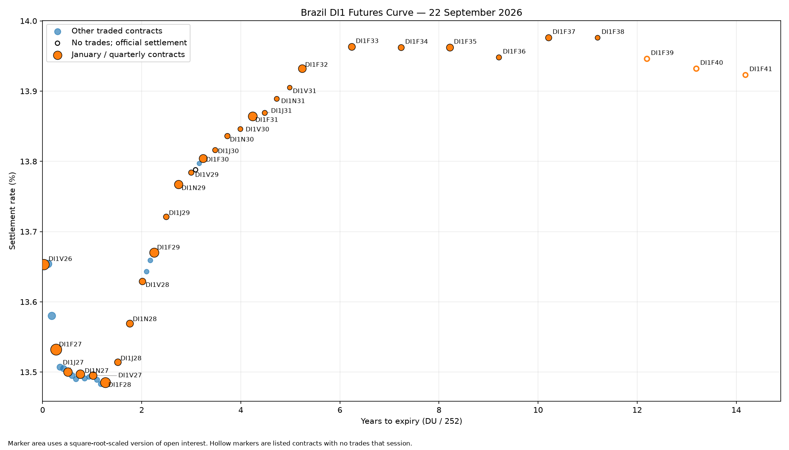
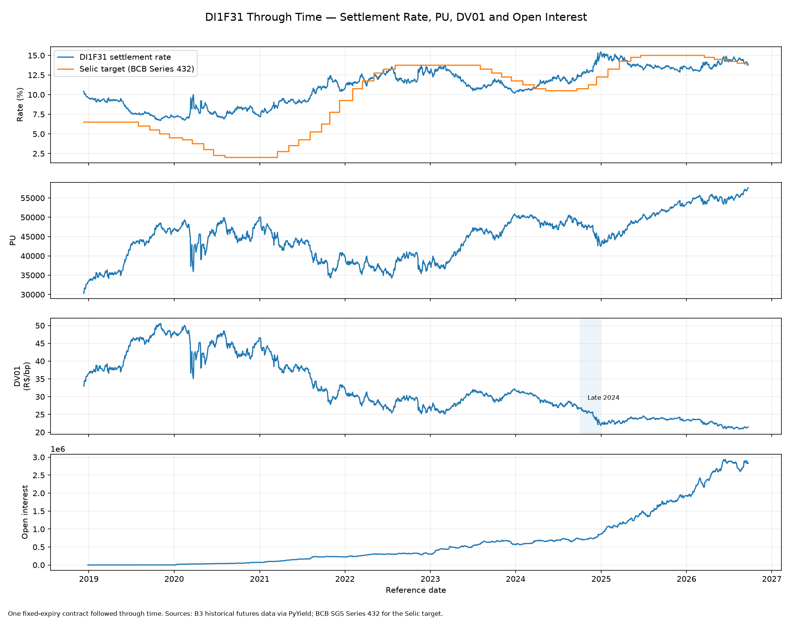

# brazil-di-curve

Builds Brazil's DI1 futures curve from B3's public historical data, and follows one contract through time against the central bank's Selic target.

DI1 futures are B3's interbank-rate (DI) futures. Each contract pays R$100,000 at expiry, and its price today reflects the average DI rate the market expects until then. Lined up by maturity, the settlement rates of all listed contracts form Brazil's main interest-rate curve.



## What it does

The script downloads the DI1 history from 2018 to 22 September 2026: 83,572 rows, one per contract per trading day. It then slices that table two ways.

1. **One date, every contract: the curve.**
   - It prints the contracts listed on 22 September 2026.
   - It reproduces B3's settlement price (PU) from the settlement rate as a check. For DI1V26, B3's PU is 99,645.13 and the rebuilt PU is 99,645.13.
   - It ranks the contracts by open interest, contracts traded and number of trades.
   - It plots the curve. Marker size follows open interest, and hollow markers are contracts that did not trade that day, so their rate is B3's official settlement rather than a traded price.
2. **One contract, every date: DI1F31 through time.**
   - DI1F31 is the contract expiring in January 2031. It is followed from its listing on 10 December 2018, across 1,936 sessions.
   - The chart shows its settlement rate against the Selic target, its PU, its DV01 and its open interest.



## Usage

Python 3.10 or later.

```
git clone https://github.com/T444CEM/brazil-di-curve.git
cd brazil-di-curve
pip install -r requirements.txt
python brazil_di_curve.py              # print the tables, save both charts to output/ and show them
python brazil_di_curve.py --no-show    # save the charts without opening windows
python brazil_di_curve.py --refresh    # download the DI1 and Selic histories again
```

The first run downloads the data, which takes a few minutes. Later runs read it from `data/` and work offline.

The curve date, the contract and the history window are constants at the top of [`brazil_di_curve.py`](brazil_di_curve.py). If you change the window, run once with `--refresh`.

## Data

The data is not included in this repository. The script downloads it into `data/`, which git ignores:

| File | One row is | Source |
|---|---|---|
| `data/di1_history.parquet` | one DI1 contract on one trading day: maturity, business days to expiry, settlement rate and price, DV01, open interest, volume | B3 historical futures data, through [PYield](https://github.com/crdcj/PYield) |
| `data/selic_history.parquet` | one day's Selic target | Banco Central do Brasil, SGS series 432 |

Rates are stored as decimals: 0.13653 means 13.653%.

## Method

Brazilian rates compound over business days, with 252 business days (*dias úteis*, DU) to the year:

```
PU               = 100,000 / (1 + rate) ^ (DU / 252)
years to expiry  = DU / 252
```

DV01 is the change in a contract's PU, in reais, for a one basis point move in its rate.

## Limits

- End of day only: settlement rates and prices, no intraday data.
- The curve is the raw set of contract rates. No interpolation or fitted curve is applied.
- PYield reads B3's public files. If B3 changes its formats, a newer PYield version may be needed (tested with 0.65.0).

## License

The code is released under the [MIT License](LICENSE). The market data it downloads belongs to B3 and Banco Central do Brasil, is subject to their terms of use, and is not included in this repository.
